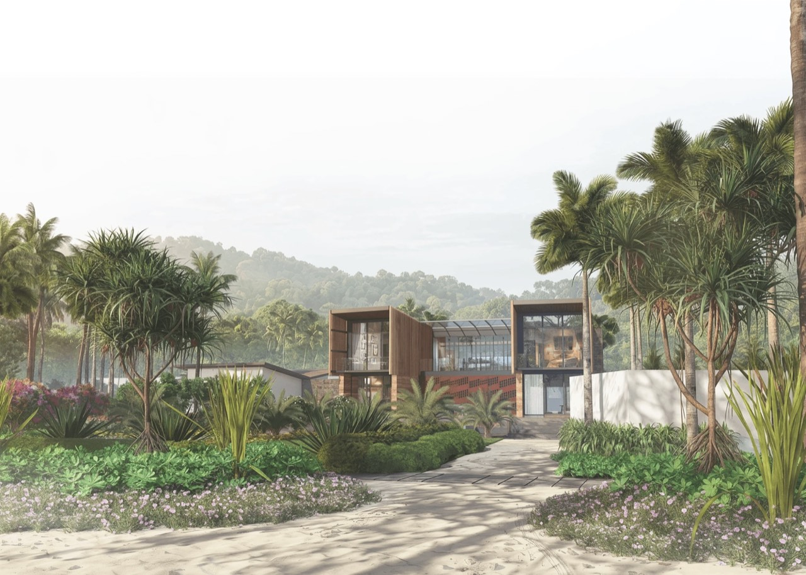

# Dela Cruz Studio

Architectural and landscape design, site planning, and 3D visualization by Nyco, based in Palawan, Philippines.

**[View the live portfolio](https://nyxdcz.github.io/delacruz-studio-portfolio/)** · [Projects](https://nyxdcz.github.io/delacruz-studio-portfolio/projects/) · [Project inquiry](https://nyxdcz.github.io/delacruz-studio-portfolio/contact/)

[](https://nyxdcz.github.io/delacruz-studio-portfolio/projects/8/)

Featured work: **Wrap Technologies Inc.**, San Vicente, Palawan.

## About the project

An independent static portfolio built with HTML, CSS, and JavaScript. It includes 12 project case studies, an interactive project fan, service descriptions, a software overview, and a project inquiry page.

Project images, branding, and fonts are bundled locally. The site runs independently of Framer and publishes through GitHub Pages. Core page content is included in the generated HTML; JavaScript adds the interactive effects.

## Run locally

Requires Node.js and Python 3. No package installation is needed.

```sh
npm run build
npm run dev
```

Open [localhost:43821](http://127.0.0.1:43821/).

## Edit the portfolio

| File | Purpose |
| --- | --- |
| [dist/projects.json](dist/projects.json) | Project names, locations, dates, descriptions, and image paths. |
| [dist/app.js](dist/app.js) | Page content, rendering, navigation, and inquiry behavior. |
| [dist/style.css](dist/style.css) and [dist/editorial.css](dist/editorial.css) | Shared styles, typography, and page layouts. |
| [dist/mobile.css](dist/mobile.css) | Phone layouts below 800px, including the opening composition and About portrait. |
| [dist/effects.js](dist/effects.js) and [dist/effects.css](dist/effects.css) | Carousels, service tabs, and supporting motion. |
| [dist/assets/](dist/assets/) | Original imagery, responsive images, logos, and fonts. |
| [dist/index.html](dist/index.html) | Shared page shell and metadata. |
| [build.mjs](build.mjs) and [render-static.mjs](render-static.mjs) | Generate content-filled pages for every route. |

Rebuild after editing page content, metadata, rendering, or project data. The generated route HTML uses the shared render functions in `dist/app.js`.

The optional [image helper](tools/prepare-images.py) regenerates responsive JPEGs on macOS. The generated images are already included, so deployment does not require this helper.

## Verify and deploy

Check a local build:

```sh
npm run build
node verify-static.mjs
```

The verifier checks generated content, local links, assets, gallery completeness, and the inquiry fallback across 17 pages.

Push to `main` to publish through the [GitHub Pages workflow](.github/workflows/pages.yml). The repository's Pages source is **GitHub Actions**. The workflow builds into `_site/`, checks the output, and deploys it under `/delacruz-studio-portfolio/`.

To prepare the same output manually:

```sh
SITE_BASE_PATH=/delacruz-studio-portfolio/ SITE_OUTPUT_DIR=_site node build.mjs
SITE_BASE_PATH=/delacruz-studio-portfolio/ node verify-static.mjs _site
```

`_site/` is generated and ignored by Git. For a host at a root domain, use `npm run build` and upload the contents of `dist/`; the host should support directory index files and a custom `404.html`.

## Project inquiries

The inquiry form validates the visitor's details and opens an email draft in their mail app. The visitor reviews and sends it there. The website does not send or store inquiries. An Email me link is also available on the inquiry page.

## Design and verification

- [Design direction](DESIGN.md): DCS branding, typography, layout decisions, and approved interactions.
- [Verification record](VERIFICATION.md): build checks, browser observations, and testing limits.
- [Font licenses](licenses/): bundled Inter Display and Martian Mono license files.
